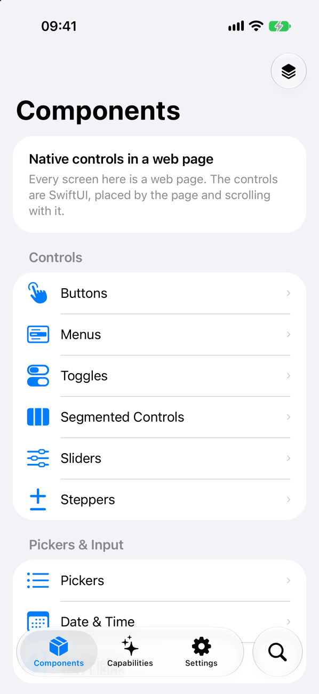
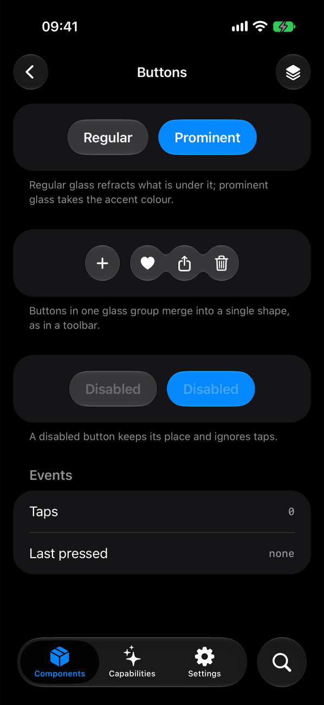
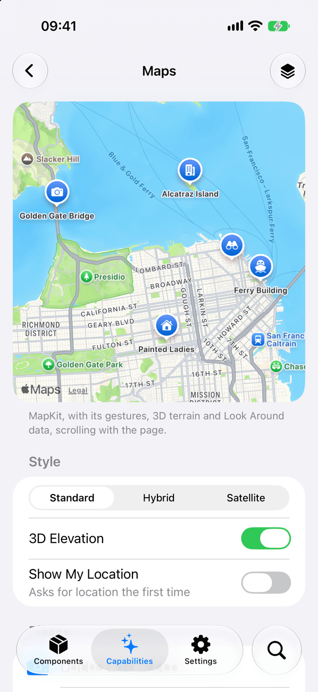
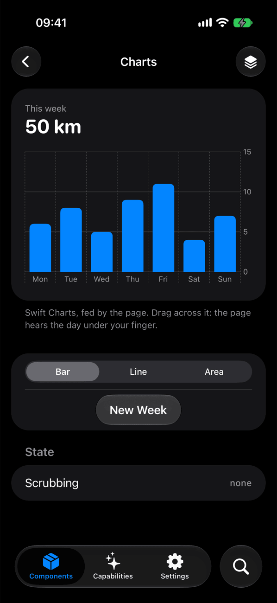

# Native Islands

Native Islands lets a web page running in a `WKWebView` use real UIKit and
SwiftUI views. You write the page once in React and mark the elements that
should be native. On iOS, the app draws those elements as native views, such as
Liquid Glass buttons, switches, maps, charts or your own components, at the
exact position of the web element. In a browser, or in an app without Native
Islands, the same page shows its web version.

<p align="center">
  
  &nbsp;
  
  &nbsp;
  
</p>
<p align="center"><sub>Each screen above is a single web page in a <code>WKWebView</code>. The glass buttons, the map and the tab bar are native views.</sub></p>

> [!WARNING]
> Native Islands is experimental. Expect bugs and missing pieces. The contract
> between page and app, and the APIs on both sides, will change between
> versions. Read [Where it stands](#where-it-stands) before you build on it.

```tsx
<GlassButton title="Continue" prominence="prominent" onPress={purchase}>
  <button className="cta">Continue</button>
</GlassButton>
```

On iOS, this is a SwiftUI button with Liquid Glass, drawn by UIKit and sampling
the page content behind it. Everywhere else, it is the `<button>` inside it.
The page has no platform checks, keeps its DOM, CSS and npm packages, and
deploys the way it does today.

## A web view is made of scroll views

The usual way to put a native view on a web page is to float it above the web
view and move it on every scroll event. We tried that first. The view is always
a frame behind, it covers sheets and footers it should sit under, and it breaks
when the page animates.

What made Native Islands possible is a detail of how WebKit works on iOS. A
`WKWebView` isn't a single flat surface. WebKit builds the page out of UIKit
views: the page scrolls inside a `UIScrollView`, and each `overflow: auto` area
gets its own native scroll view, a `WKChildScrollView`. Native Islands adds
each native view inside the scroll view that contains its element, at the
element's position, next to the layers WebKit draws the page with.

This is the view hierarchy of a running page, as Xcode's view debugger shows
it:

```text
IslandWebView                         the WKWebView
└─ WKScrollView                       the page's own scroll view
   ├─ WKContentView                   the page's content layers
   │  └─ … WKChildScrollView          a scrolling route or list
   │        ├─ (WebKit's layers for that area)
   │        └─ native view            ← a glass button, in place
   └─ native view                     ← an island on the page itself
NativeIslands screen layer            ← only for position: fixed elements
```

Because each native view sits in the right scroll view, UIKit handles most of
the hard parts. The view scrolls with the page on every frame, including
momentum and rubber-banding, with no JavaScript involved. When a route slides,
fades or scales, WebKit animates its scroll view with Core Animation and the
native view moves with it. Web content that WebKit draws above that scroll
view, such as a footer, a sheet or the next page, covers the native view the
same way it would cover the web element. And because the content behind a
glass button is the page itself, the glass bends the page's own gradients,
images and video.

<p align="center">
  
  &nbsp;
  
</p>
<p align="center"><sub>The same page with islands off (left) and on (right). Only the buttons and the tab bar change, and nothing else on the page moves.</sub></p>

## How it works

### The page owns layout

Layout stays with the page. For each island, the page measures the web
element, finds the scroll view it belongs to and sends the app a mount
message. The app adds the native view there and replies. Only after the reply
does the page fade out the web version.

```text
page (React)                               app (Swift)
────────────                               ───────────
<GlassButton> renders its web children
measures them, picks the anchor ─ mount ─► NativeIslandsHost
  (page, scroller or screen)               finds the matching scroll view,
                                           adds the native view, replies
web version fades out ◄───────── ack ─────
onPress runs      ◄──────────── event ──── user taps the native button
state, requests, commands both ways ◄────► typed text, "validate this", focus
```

When an element moves or resizes, the page measures it again and the app moves
the native view to match. If web content covers part of an island, that part
is cut out of the native view. Translucent covers, such as a sheet's dimmed
backdrop, are drawn over the island in their own colour, so the island can
stay native underneath them.

Page and app exchange five kinds of message. Each kind goes in one direction
and has one purpose:

| Kind         | Direction                    | What it's for                                                    | Example                |
| ------------ | ---------------------------- | ---------------------------------------------------------------- | ---------------------- |
| **props**    | page → native                | What to draw. Sent again when React re-renders with new values.  | `title`, `prominence`  |
| **events**   | native → page                | Something happened. No reply, like a DOM event.                  | `press`, `submit`      |
| **state**    | native → page, kept          | A value the native view owns that the page can read at any time. | the text typed so far  |
| **requests** | native → page, with a reply  | The native view asks the page something and waits for the reply. | "is this email valid?" |
| **commands** | page → native, with a result | The page tells the native view to act and waits for the result.  | `focus`, `reset`       |

A component declares only the kinds it uses:

```tsx
const SignupForm = defineNativeComponent<{
  props: { title: string };
  events: { submit: { email: string } };
  state: { email: string };
  requests: { validateEmail: { payload: { email: string }; result: { error?: string } } };
  commands: { focus: { args: void; result: void } };
}>("signupForm");
```

### Motion without a message per frame

If the page sent a message on every frame of an animation, the native view
would lag the same way a floating overlay does. Instead, the page describes
the common kinds of motion once and the app runs them itself.

For a `position: sticky` element, the page sends its sticky box, inset and
travel, and the app applies the same sticky rule on each scroll, so the native
view sticks and unsticks in the same frame as the web content. When a box
clips its content, as an accordion does while it opens, the app clips the
native view to the visible part. Elements inside a rotated, scaled or
translucent box are drawn with the same rotation, scale and opacity. Islands
outside any scrolling area, such as a navigation bar button, receive their
page's CSS slide (translate keyframes, Bézier easing and progress), and the
app runs the same slide in Core Animation.

The page can't describe 3D transforms, filters or clip paths this way, so an
island inside one of those shows its web version.

Each of these is a feature the host offers in its capability.
[`docs/host-features.md`](docs/host-features.md) lists them with exactly what
the page sends for each.

### No flash of the web version

Users should never see the web version of a button and then the native one.
The app keeps a new page covered until the page reports that every island in
its first frame is drawn. A timeout makes sure a page without islands still
appears. Pages that are rendered but not yet visible, such as the next step of
a flow, mount their islands ahead of time, so they slide in already native. An
island that comes back, such as a search result that reappears, reuses its
existing native view instead of creating a new one.
[`docs/host-features.md`](docs/host-features.md) has the rules for reuse and
for pages that wait off screen.

### Public API only, with a web fallback

Native Islands uses only public UIKit and WebKit API, including
`UIScrollView`, `hitTest`, `WKUserScript`, `WKScriptMessageHandler` and
`UIGlassEffect`. What WebKit doesn't guarantee is how it arranges those views,
so the host identifies a `WKChildScrollView` by its size and scroll offset
rather than by its position in the view hierarchy.

When something doesn't match, the page falls back to the web version. If a
future iOS changes WebKit's view layout, no scroll view matches and the element
stays web. The same happens in a browser, in an app that hasn't registered the
component, or when the page can't tell whether the app can draw it. The page
keeps working in each of these cases, with fewer native elements.

## What we measured

Every claim above is backed by a test that runs on each change, and the results
are recorded in this repository.

### Compatibility

We test on every iOS release from 16 to 27, which are the releases CI and our
simulators can run today. Islands are native on all of them. Before iOS 26,
glass views use a system material in the same shape, matching how Apple's own
controls look on those releases. The package also builds for and offers
islands on iOS 15, but we haven't run it there.

| iOS       | Islands | Glass looks like | WebKit probe | Swift suite | Alignment (0.5 pt)  | Screenshots |
| --------- | ------- | ---------------- | ------------ | ----------- | ------------------- | ----------- |
| 16.0–16.4 | native  | system material  | CI only      | CI only     | –                   | –           |
| 17.5      | native  | system material  | pass         | pass        | pass                | `iOS-17`    |
| 18.6      | native  | system material  | pass         | pass        | pass                | `iOS-18`    |
| 26.1–26.5 | native  | Liquid Glass     | pass         | pass        | pass, except 26.3.1 | `iOS-26`    |
| 27.0–27.2 | native  | Liquid Glass     | pass         | pass        | pass                | `iOS-27`    |

Each column is a different kind of test. The WebKit probe loads a fixture page
into a real `WKWebView` on each iOS runtime, records the view tree and compares
the trees across versions, so a change in WebKit's layout fails here before it
reaches an app. The Swift suite runs the host's tests on each runtime.
TestHost's UI tests open every scenario page and fail if a native view is more
than 0.5 pt from its web element; they also compare each page with screenshot
baselines kept for each iOS major version. These results are from 2026-11-04.
[`docs/compatibility.md`](docs/compatibility.md) has the full matrix, what
WebKit changed between versions, why 26.3.1 skips the UI tests, and how to add
a new iOS release.

### Performance

We measured a page holding a column of SwiftUI glass buttons on an iPhone 18
Pro with iOS 27.2, taking the median of three runs:

| Islands | Page shown, every island drawn | Memory per island | Dropped frames while scrolling | One full relayout (JS) |
| ------: | -----------------------------: | ----------------: | -----------------------------: | ---------------------: |
|      10 |                         165 ms |            971 KB |                              0 |                 8.8 ms |
|      50 |                         247 ms |            421 KB |                              0 |                19.3 ms |
|     100 |                         483 ms |            357 KB |                              0 |                37.9 ms |

"Page shown" is the time from creating the web view to revealing the page with
every island drawn. Scrolling, sticky elements and page transitions don't get
slower as islands are added, because UIKit moves the views. Each island after
the tenth adds about 290 KB of app memory. The cost that does grow is a full
relayout of the page, at about 0.32 ms of main-thread JavaScript per island.
That fits within one frame for up to about 30 islands and takes a bit over two
frames for 100. [`docs/performance.md`](docs/performance.md) defines each measurement
and explains how to repeat it on your own phone.

## Where it stands

Native Islands is early. The example app and a gallery of regression pages run
on every iOS release from 16 to 27, but you should expect bugs, missing pieces
and breaking changes. Most cross-platform frameworks go through this stage,
and we decided to go through it in public.

These are the limits we know of today. None of them blocks a typical page:

- An element that moves by layout, such as one being resized or having its
  width animated, gets a new message on each frame, so its native view can be
  one frame behind while it moves. Scrolling, sticky elements and page slides
  aren't affected.
- A full relayout costs about 0.32 ms per island on an iPhone 18 Pro (see
  [Performance](#performance)). On pages with many islands, avoid animating
  layout.
- An island inside a 3D transform, a filter or a clip path shows its web
  version.
- WebKit creates the scroll view for a scrolling area a few frames after it
  lays the area out. The host waits up to a second for it, and if it doesn't
  appear, the island stays web.
- After a fast fling, buttons in a carousel nested in a list can be about
  0.5 pt off until the next layout pass. The alignment tests mark this case as
  an expected failure.
- Only iOS has a host. There is no Android host yet.

### Prior work

Some of this has been done before. Map plugins for Cordova and Capacitor draw
a native map behind a transparent web view. Hotwire Native lets a page drive
native navigation bars and toolbars. An Expo app placed a fixed set of native
controls in a web view's main scroll view. We haven't found anything that
places arbitrary app-registered views inside WebKit's own scroll views, keeps
them in place through page transitions and passes values in both directions.
If you know of prior work, please open an issue so we can credit it.

---

## Getting started

Native Islands has two packages, one for each side. They share a contract:
`tests/fixtures/messages.json` contains an example of every message, and both
packages' tests decode it, so a change on one side that the other can't read
fails a test.

| Side       | Package                   | Where                                  |
| ---------- | ------------------------- | -------------------------------------- |
| App (iOS)  | `NativeIslands` (SwiftPM) | `packages/swift/Sources/NativeIslands` |
| Page (web) | `native-islands` (npm)    | [`packages/web/`](packages/web/)       |

Install the page side from npm:

```bash
npm install native-islands
```

Add the app side with Swift Package Manager, from
`https://github.com/superwall/native-islands`.

### On the page

```tsx
import { defineNativeComponent, NativeIslandsProvider } from "native-islands/react";

const GlassButton = defineNativeComponent<{
  props: { title: string; prominence?: "regular" | "prominent" };
  events: { press: undefined };
}>("glassButton");

<NativeIslandsProvider>
  <GlassButton title="Continue" prominence="prominent" onPress={purchase}>
    <button>Continue</button>
  </GlassButton>
</NativeIslandsProvider>;
```

The children are the web version. If the app registered `glassButton`, it
draws the native button in their place; otherwise the children show. The full
page API, including state, requests, commands and use without React, is in
[`packages/web/README.md`](packages/web/README.md). A package of ready-made
native components is in progress. Until it ships, the example app has glass
buttons and controls you can copy.

### In the app

```swift
import NativeIslands

NativeComponentRegistry.shared.register("glassButton") { component in
  Button(component.props.string("title") ?? "") {
    component.emit("press")
  }
}

let webView = IslandWebView(frame: .zero)
webView.load(URLRequest(url: pageURL))
```

`IslandWebView` is a `WKWebView` with a `NativeIslandsHost` attached. Before
the page loads, it tells the page which components are registered on
`NativeComponentRegistry.shared`.

To use your own web view, attach `NativeIslandsHost(webView:)` before the first
load and forward two calls to it, as `IslandWebView` does:

- `hitTest(_:with:webHit:)` from your `hitTest(_:with:)`, so islands in inner
  scrolling areas receive their taps;
- `webViewDidMoveToWindow()` from your `didMoveToWindow()`, so each island's
  hosting controller becomes a child of the view controller that shows the web
  view and can present sheets, menus and pickers.

```swift
override func didMoveToWindow() {
  super.didMoveToWindow()
  islands.webViewDidMoveToWindow()
}
```

### Revealing the page

The host covers each new document with the web view's background colour until
the page reports that its islands are drawn. The React provider sends that
report once every island in the first frame is either drawn or settled on its
web version. Without React, call `islands.announceReady()` yourself. The host
then waits two frames, so WebKit has laid out the page with the safe area, and
reveals it. If the page never reports, the host reveals it after a timeout:

```swift
let host = NativeIslandsHost(webView: webView, reveal: .whenIslandsReady(timeout: 2))
host.onReady = { reason in present() } // .ready or .timedOut
```

For web views that load pages without the library, pass `.immediately`.

When the host offers the `layered` feature, a page that is rendered but not
yet visible, such as the next screen of a flow, keeps its islands in place.
Mark it with `data-island-phase` or `inert` and position it off screen or
underneath instead of using `display: none`. Its islands then mount right away
and move with it when it slides in.

## Try the example app

Islands, in `examples/`, is a component catalogue styled like an iOS 26 app.
Every screen in it is one web page in a `WKWebView`, with large titles, inset
grouped lists, push and swipe-back navigation, a native navigation bar that
stays in place while screens slide under it, and a floating Liquid Glass tab
bar.

- Components: glass buttons, menus, toggles, segmented controls, sliders,
  steppers, pickers, date and colour pickers, text fields, gauges, SF Symbol
  effects and Swift Charts.
- Capabilities: a MapKit map, video with Picture in Picture, the live camera,
  the photo picker passing photos back to the page, permission prompts,
  haptics and the share sheet.
- Search: a native search field that filters every demo as you type.
- Settings: appearance and accent colour, which the native views follow, and a
  Native Islands switch that replaces every island with its web version.

<p align="center">
  
  &nbsp;
  
</p>

You need macOS with Xcode 26 or later, [Bun](https://bun.sh) 1.4.4 or later,
and [XcodeGen](https://github.com/yonaskolb/XcodeGen).

```bash run
bun install
cd examples/ios && xcodegen && open Islands.xcodeproj
```

Run it on a simulator or an iPhone. The page is bundled with the app, so it
needs no network except for the sample video. To open a single screen, launch
it with `-screen <id>` (for example `-screen maps`) or `-tab <id>`. The camera
and Picture in Picture need a real iPhone.

The same page also runs in a browser. With `?native=simulate`, it draws a
magenta outline where each native view would be:

```bash run
bun run --cwd examples/showcase dev
```

Then open `http://localhost:5173/?native=simulate`, or
`http://localhost:5173/?native=simulate&screen=buttons` for a single screen.

The host draws the same outline, with the component's name, over the real
native views in any app. It is off by default. Turn it on from code, in any
build:

```swift
webView.islands?.showsOutlines = true
```

or launch a Debug build with `-NativeIslandsOutlines YES`. Release builds
ignore the argument, so outlines show there only when the app turns them on.
In Islands, View Mode › Outlines switches them.

`tests/pages/` holds the scenario gallery the tests run against: regression
pages for each scenario, and a three-page flow where islands slide in with
their page. `tests/ios/` is TestHost, the app that bundles those pages. In a
browser, `?route=<name>` opens one page (`buttons`, `controls`, `scrolling`,
`motion`, `overlays`, `stress`, `state` or `flow-plans`). In TestHost, the
launch argument is `-route <name>`, and `-NativeIslandsAlignmentLog YES` logs
each native frame next to its DOM rect.

## Developing

```bash
bun install
bun run --cwd packages/web test:run
bun run --cwd packages/web typecheck
xcodebuild test -scheme NativeIslands -destination 'platform=iOS Simulator,name=iPhone 17'
scripts/ui-tests.sh          # alignment and screenshots on several simulators
scripts/compat-matrix.sh     # the WebKit probe on every installed iOS runtime
```

[`CONTRIBUTING.md`](CONTRIBUTING.md) lists every check, the rules for changing
the contract, and the code style.

## License

Native Islands is released under the
[Functional Source License 1.1, MIT Future License](LICENSE) (FSL-1.1-MIT).
You can use, modify and ship it in your own apps and products for any purpose
except a competing use: a commercial product or service that substitutes for
Native Islands, or for a Superwall product built on it, or that offers
substantially the same functionality. Each release becomes available under the
MIT license two years after it is published.

Because of the competing-use limit, FSL is not an open source license in the
sense the [Open Source Initiative](https://opensource.org/osd) defines, which
allows no limits on who may use the code or for what. It belongs to
[Fair Source](https://fair.io), a group of licenses that publish the source and
allow almost any use, as Sentry and Codecov do with theirs.

Copyright 2026 Superwall, Inc.
