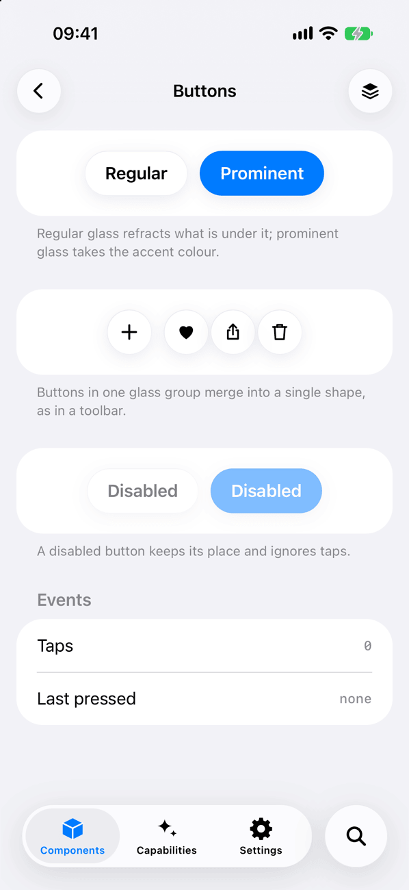
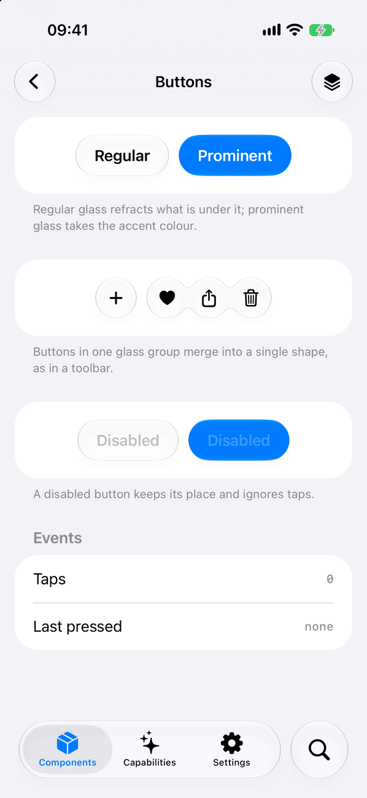
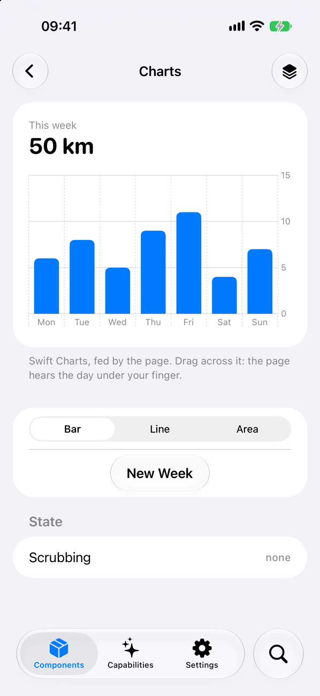

# Native Islands

Write a React page. Get a real iOS app.

Native Islands puts actual SwiftUI and UIKit views inside a web page running in
a `WKWebView`. Not lookalikes in CSS: the real Liquid Glass buttons, switches,
sliders, maps, charts, pickers, or any view you write yourself, sitting exactly
where the web element was and scrolling with the page like it was always there.

You keep writing normal React and JavaScript. Your DOM, your CSS, your npm
packages, your deploys. In a browser, the same page just shows its web version.

<p align="center">
  
  &nbsp;
  
  &nbsp;
  
</p>
<p align="center"><sub>Every screen here is one web page. The glass buttons, the map and the tab bar are native.</sub></p>

```tsx
<GlassButton title="Continue" prominence="prominent" onPress={purchase}>
  <button className="cta">Continue</button>
</GlassButton>
```

On an iPhone, that's a SwiftUI button with Liquid Glass, and the glass bends
your page's own gradients and images behind it. Everywhere else, it's the
`<button>` inside. No platform checks.

> [!WARNING]
> This is experimental. Expect bugs, missing pieces and breaking changes
> between versions. See [Known limits](#known-limits).

## How it pulls this off

The obvious way to put a native view on a web page is to float it on top and
chase the page on every scroll event. We tried that. It's always a frame
behind, it covers sheets it should sit under, and it falls apart the moment
the page animates.

The trick is that a `WKWebView` isn't one flat surface. WebKit builds the page
out of UIKit views: the page scrolls in a `UIScrollView`, and every
`overflow: auto` area gets its own native scroll view. Native Islands drops
each native view straight into the scroll view that holds its element:

```text
IslandWebView                         the WKWebView
└─ WKScrollView                       the page's own scroll view
   ├─ WKContentView                   the page's content layers
   │  └─ … WKChildScrollView          a scrolling route or list
   │        ├─ (WebKit's layers for that area)
   │        └─ native view            ← a glass button, in place
   └─ native view                     ← an island on the page itself
NativeIslands screen layer            ← only for position: fixed elements
```

So UIKit does the hard work for free. The view scrolls with the page on every
frame, momentum and rubber-banding included, with zero JavaScript. When a route
slides or fades, the native view goes with it. A sheet or footer drawn above
covers it just like it would cover the web element.

<p align="center">
  
  &nbsp;
  
</p>
<p align="center"><sub>Islands off (left) and on (right). Only the buttons and the tab bar change. Nothing else moves.</sub></p>

The page stays in charge of layout. It measures each element and tells the app
where to put the native view, and only fades out the web version once the
native one is on screen. Sticky headers, accordions, rotated or faded boxes and
page slides are described once and replayed natively, not streamed frame by
frame. A new page stays covered until its islands are drawn, so you never see
the web button flash before the native one.

It's all public UIKit and WebKit API. If something doesn't line up, like a
future iOS shuffling WebKit's views, that element simply stays web. The page
keeps working. [`docs/host-features.md`](docs/host-features.md) goes deep on
all of this.

## Does it hold up

It runs on every iOS from 16 to 27, and islands are native on all of them.
Before iOS 26, glass falls back to the system material, like Apple's own
controls do. [`docs/compatibility.md`](docs/compatibility.md) has the
per-version details.

On an iPhone 18 Pro, a page with 100 glass buttons shows up fully native in
under half a second and scrolls without dropping a frame. The one cost that
grows is a full relayout, about 0.32 ms of JavaScript per island.
[`docs/performance.md`](docs/performance.md) has the numbers and how to measure
on your own phone.

### Known limits

- An element whose size is being animated can trail its web element by a
  frame. Scrolling, sticky elements and page slides aren't affected.
- On pages with lots of islands, avoid animating layout (each relayout costs
  about 0.32 ms per island).
- An island inside a 3D transform, a filter or a clip path shows its web
  version.
- WebKit creates the scroll view for a new scrolling area a few frames late.
  The host waits up to a second; if it never shows, the island stays web.
- After a fast fling, a carousel nested in a list can be about 0.5 pt off
  until the next layout pass.
- iOS only for now. No Android host yet.

Some of this has been done before: Cordova and Capacitor map plugins draw a
map behind a transparent web view, Hotwire Native drives native nav bars, and
an Expo app put fixed native controls in a web view's main scroll view. We
haven't seen anything that puts any view you register inside WebKit's own
scroll views, keeps it there through page transitions and talks both ways. If
you have, open an issue and we'll credit it.

---

## Getting started

There are two packages, one for each side:

| Side       | Package                              | Where                                  |
| ---------- | ------------------------------------ | -------------------------------------- |
| App (iOS)  | `NativeIslands` (SwiftPM, CocoaPods) | `packages/swift/Sources/NativeIslands` |
| Page (web) | `native-islands` (npm)               | [`packages/web/`](packages/web/)       |

Each side also has an optional set of ready-made controls: the
`NativeIslandsComponents` library in the same Swift package (and its own pod,
`pod 'NativeIslandsComponents'`), and the `native-islands/components` entry in
the npm package.

Install the page side from npm:

```bash
npm install native-islands
```

Add the app side with Swift Package Manager, from
`https://github.com/superwall/native-islands`, or with CocoaPods, which React
Native and Expo apps build through:

```ruby
pod 'NativeIslands'
```

A pod of your own depends on it with `s.dependency 'NativeIslands'`.

### On the page

```tsx
import { defineNativeComponent, NativeIslandsProvider } from "native-islands/react";

const GlassButton = defineNativeComponent<{
  props: { title: string; prominence?: "regular" | "prominent" };
  events: { press: undefined };
}>("glassButton");

<NativeIslandsProvider>
  <GlassButton title="Continue" prominence="prominent" onPress={purchase}>
    <button>Continue</button>
  </GlassButton>
</NativeIslandsProvider>;
```

The children are the web version. If the app registered `glassButton`, it
draws the native button in their place; otherwise the children show.

Components can do more than take props and fire events. A text field can keep
its text as state the page reads, ask the page "is this email valid?" and wait
for the answer, or take a `focus` command from the page:

```tsx
const SignupForm = defineNativeComponent<{
  props: { title: string };
  events: { submit: { email: string } };
  state: { email: string };
  requests: { validateEmail: { payload: { email: string }; result: { error?: string } } };
  commands: { focus: { args: void; result: void } };
}>("signupForm");

<SignupForm
  ref={form}
  title="Join"
  onSubmit={({ email }) => send(email)}
  onEmailChange={(email) => setDraft(email)}
  onValidateEmail={({ email }) => ({ error: valid(email) ? undefined : "Check it" })}
>
  <WebSignupForm />
</SignupForm>;

await form.current?.command("focus");
```

The full page API, including use without React, is in
[`packages/web/README.md`](packages/web/README.md).

### In the app

```swift
import NativeIslands

NativeComponentRegistry.shared.register("glassButton") { component in
  Button(component.props.string("title") ?? "") {
    component.emit("press")
  }
}

let webView = IslandWebView(frame: .zero)
webView.load(URLRequest(url: pageURL))
```

`IslandWebView` is a `WKWebView` with a `NativeIslandsHost` attached. Before
the page loads, it tells the page which components are registered on
`NativeComponentRegistry.shared`.

To use your own web view, attach `NativeIslandsHost(webView:)` before the first
load and forward two calls to it, as `IslandWebView` does:

- `hitTest(_:with:webHit:)` from your `hitTest(_:with:)`, so islands in inner
  scrolling areas receive their taps;
- `webViewDidMoveToWindow()` from your `didMoveToWindow()`, so each island's
  hosting controller becomes a child of the view controller that shows the web
  view and can present sheets, menus and pickers.

```swift
override func didMoveToWindow() {
  super.didMoveToWindow()
  islands.webViewDidMoveToWindow()
}
```

### Ready-made controls

For the common controls you don't have to write either side. Add the
`NativeIslandsComponents` library to the app and register it once:

```swift
import NativeIslandsComponents

NativeIslandsComponents.register()
```

On the page, import the components and the stylesheet for their web versions:

```tsx
import { GlassButton, Toggle } from "native-islands/components";
import "native-islands/components.css";

<GlassButton title="Continue" prominence="prominent" onPress={purchase} />
<Toggle label="Notifications" isOn={on} onChange={setOn} />
```

That one call registers 34 islands, enough to build a whole app with no Swift
of your own:

- **Controls:** `GlassButton`, `CloseButton`, `Menu`, `Toggle`,
  `SegmentedControl`, `Slider`, `Stepper`, `Picker`, `DatePicker`,
  `ColorPicker` and `TextField`.
- **Presentations:** `Sheet` (detents, grabber, interactive dismiss),
  `FullScreenCover`, `Popover`, `Inspector`, `Alert` and `ConfirmationDialog`.
  A sheet, cover, popover or inspector holds another page in its own web view
  with its own islands; that page closes itself and messages back with
  `usePresentedPage()`.
- **App chrome:** `TabView` with a bottom `TabAccessory` and a `SearchTab`,
  `TabBar`, `NavigationStack` with large titles, `NavigationBar`, `Toolbar`
  and `SearchField`.
- **Lists:** `List`, with symbols, values, badges, swipe actions, selection,
  drag to reorder and delete in edit mode, and rows with children as
  disclosure groups nested into an outline. Rows hold text and symbols, not
  web content.
- **Indicators:** `SystemSymbol`, `SymbolEffect`, `Gauge` and `Tip` (TipKit).
- **Media and system:** `Video` (AVKit, with Picture in Picture), `Camera`,
  `PhotoPicker`, `HapticButton`, `ShareButton`, `Permission`, `Haptics`
  (Core Haptics patterns, through `useHaptics()`), `Notifications` (local
  notifications, through `useNotifications()`), `ContextMenu` and
  `LongPressGesture` over the page's own elements, and `MaterialBackground`
  (system materials and Liquid Glass).

Every tab, bar item, row and button is a prop, so a page adds one without an
app update:

```tsx
const sheet = useSheet();

<Toolbar items={[{ id: "share", systemImage: "square.and.arrow.up" }, { kind: "flexibleSpace" }, { id: "edit", title: "Edit", prominent: true }]} onSelect={act} />
<Button onClick={sheet.present}>Settings</Button>
<Sheet {...sheet.props} url="/settings" detents={["medium", "large"]} onDismiss={({ result }) => apply(result)} />
```

The map and the chart live in libraries of their own, so an app links MapKit
and Swift Charts only when its pages use them. Register them the same way,
with `NativeIslandsMaps.register()` and `NativeIslandsCharts.register()`.

Some islands need Info.plist keys, but only when a page uses them:

| Component    | Swift library             | Info.plist keys                                                                                                     |
| ------------ | ------------------------- | ------------------------------------------------------------------------------------------------------------------- |
| `Camera`     | `NativeIslandsComponents` | `NSCameraUsageDescription`                                                                                          |
| `Permission` | `NativeIslandsComponents` | the usage description of each kind a page asks for: camera, microphone, location or photos; notifications need none |
| `MapView`    | `NativeIslandsMaps`       | `NSLocationWhenInUseUsageDescription`, only if a page sets `showsUser`                                              |

`Notifications` needs no key; it asks for permission when the page calls
`requestAuthorization()`. When the app has no notification delegate of its
own, the library becomes it, to show banners while the app is open and tell
the page which notification was tapped. Push notifications need a server and
aren't included.

Because `NativeIslandsComponents` links the camera, location and photo
frameworks, App Store Connect may warn about a missing purpose string even when
no page uses those islands. Add the keys, or register only what you use with
`NativeIslandsComponents.register(only:)`; the warning comes from linking, so
the second does not silence it. `Video`
keeps playing in Picture in Picture over other apps only when the app has the
`audio` background mode. `Chart` needs iOS 16 and `Tip` iOS 17; before that,
the page shows their web versions.

Each component draws its own web version, which matches the native control's
size and shape, and takes children to replace it. The package ships no SF
Symbol drawings for the web, so a button's `icon` and a symbol's children are
your own. The web versions follow the `--ni-*` custom properties in
`native-islands/components.css`, such as `--ni-accent` and `--ni-glass`.

A chart takes series rather than a flat list, so one chart can compare several
things on a category, number or date axis:

```tsx
<Chart
  kind="bar"
  series={[
    { id: "run", name: "Running", points: [{ x: "Mon", y: 4 }, { x: "Tue", y: 6 }] },
    { id: "ride", name: "Cycling", kind: "line", points: [{ x: "Mon", y: 10 }] },
  ]}
  yAxis={{ title: "km" }}
  onSelect={({ x, values }) => show(x, values)}
/>
```

To register only some, pass `only: [.glassButton, .toggle]`. A component the
app registers later under the same name, such as its own `toggle`, replaces
the built-in one, and the host logs a debug message saying so.

### Revealing the page

The host covers each new page with the web view's background colour until the
page says its islands are drawn. The React provider does that for you; without
React, call `islands.announceReady()`. If the page never says so, the host
reveals it after a timeout:

```swift
let host = NativeIslandsHost(webView: webView, reveal: .whenIslandsReady(timeout: 2))
host.onReady = { reason in present() } // .ready or .timedOut
```

For web views that load pages without the library, pass `.immediately`.

When the host offers the `layered` feature, a page that is rendered but not
yet visible, such as the next screen of a flow, keeps its islands in place.
Mark it with `data-island-phase` or `inert` and position it off screen or
underneath instead of using `display: none`. Its islands then mount right away
and slide in already native.

## Try the example app

Islands, in `examples/`, is a component catalogue that looks and feels like an
iOS 26 app: large titles, inset grouped lists, push and swipe-back navigation,
a native nav bar and a floating Liquid Glass tab bar. Every screen is one web
page.

- Components: glass buttons, menus, toggles, segmented controls, sliders,
  steppers, pickers, date and colour pickers, text fields, gauges, SF Symbol
  effects and Swift Charts.
- Capabilities: a MapKit map, video with Picture in Picture, the live camera,
  the photo picker passing photos back to the page, permission prompts,
  haptics and the share sheet.
- Search: a native search field that filters every demo as you type.
- Settings: appearance and accent colour, which the native views follow, and a
  Native Islands switch that turns every island back into its web version.

<p align="center">
  
  &nbsp;
  
</p>

You need macOS with Xcode 26 or later, [Bun](https://bun.sh) 1.4.4 or later,
and [XcodeGen](https://github.com/yonaskolb/XcodeGen).

```bash run
bun install
cd examples/ios && xcodegen && open Islands.xcodeproj
```

Run it on a simulator or an iPhone. The page is bundled with the app, so it
needs no network except for the sample video. To open a single screen, launch
it with `-screen <id>` (for example `-screen maps`) or `-tab <id>`. The camera
and Picture in Picture need a real iPhone.

The same page also runs in a browser. With `?native=simulate`, it draws a
magenta outline where each native view would be:

```bash run
bun run --cwd examples/showcase dev
```

Then open `http://localhost:5173/?native=simulate`, or
`http://localhost:5173/?native=simulate&screen=buttons` for a single screen.

To see the same outlines over the real native views in any app, turn them on
from code:

```swift
webView.islands?.showsOutlines = true
```

or launch a Debug build with `-NativeIslandsOutlines YES` (Release builds
ignore it). In Islands, View Mode › Outlines switches them.

## Developing

```bash
bun install
bun run --cwd packages/web test:run
bun run --cwd packages/web typecheck
xcodebuild test -scheme NativeIslands-Package -destination 'platform=iOS Simulator,name=iPhone 17'
scripts/ui-tests.sh          # alignment and screenshots on several simulators
scripts/compat-matrix.sh     # the WebKit probe on every installed iOS runtime
```

`tests/pages/` has the scenario pages and `tests/ios/` the TestHost app that
runs them. [`CONTRIBUTING.md`](CONTRIBUTING.md) has every check and the code
style.

## License

[FSL-1.1-MIT](LICENSE). Use it, change it and ship it in your apps, free. The
one thing you can't do is build a competing product out of it. Two years after
each release, that release becomes plain MIT. Because of that one limit, it
isn't OSI open source.

Copyright 2026 Superwall, Inc.
